# Portfolio Handoff — Web Editor

**Audience:** the agent building the detailed portfolio page.
**Scope:** one case study covering two completed projects that form a single system.
**Language:** page copy is **English**. Section instructions are for you, not for the page.

> Everything marked **PENDING** is media that will be supplied later. Keep the slot, the
> caption, and the alt text; drop in the file when it arrives.

---

## 1. Page metadata

| Field | Value |
| --- | --- |
| Title tag | Highway Lane Occupancy & Hogging Detection — Computer Vision Case Study |
| H1 | Highway Lane Occupancy & Hogging Detection |
| Slug | `/projects/highway-lane-occupancy` |
| Meta description | A computer vision pipeline that maps highway CCTV vehicles to six calibrated lanes and emits rule-based lane-hogging events, plus a Kafka, DuckDB, and Streamlit data platform. |
| Primary keyword | highway lane occupancy detection |
| Secondary keywords | vehicle tracking YOLO ByteTrack, lane hogging detection, computer vision portfolio, Kafka data pipeline, Streamlit dashboard |
| Open Graph image | `assets/lane_mapping.jpg` (1434×1076, crop to 1200×630) |
| Estimated read time | 7–9 minutes |
| Suggested tags | Computer Vision, Python, YOLO, Kafka, DuckDB, Streamlit |

**Do not** use "real-time traffic enforcement", "AI violation detection", or "number plate
recognition" in metadata. They set the wrong expectation and are not what was built.

---

## 2. Hero

**Eyebrow:** Computer Vision · Data Engineering

**Headline (copy):**

> Turning highway CCTV into lane-occupancy data

**Subhead (copy):**

> A two-part system: a vision pipeline that detects and tracks vehicles across six
> calibrated lanes and flags rule-based lane hogging, and a streaming data platform that
> moves those events through Kafka into a DuckDB and Streamlit dashboard.

**Stat strip (copy):**

| 158 | 111 | 8.65 fps | 109 |
| --- | --- | --- | --- |
| vehicles tracked | events from a 5-minute clip | on CPU | automated tests |

**Buttons:** `Read the case study` (anchor to overview) · `View the code` (repo link)

**Hero media:** `assets/lane_mapping.jpg` — the calibrated six-lane overlay. It is the
strongest single image because it explains the geometry instantly.

---

## 3. Overview section

**Section label:** The problem
**Heading (copy):**

> Lane occupancy is a geometry problem before it is a machine-learning problem

**Body (copy, ~120 words):**

> Highway cameras already record everything. The hard part is turning pixels into
> something a data team can query: which lane is each vehicle in, how long did it stay,
> did it change lanes, and did it sit in the overtaking lane longer than the rules allow?
>
> This project answers those questions for a real night-time toll-road camera at Tj. Priok
> KM 58+400 in Jakarta. The camera sits on the median, so both carriageways are visible:
> three northbound lanes and three southbound lanes, with the median-side lane acting as
> the overtaking lane in each direction.
>
> The output is not a black-box score. It is a stream of typed events — lane enter, lane
> exit, lane change, hogging indication — with timestamps, track IDs, lane names, and
> short video evidence.

**Callout (copy):**

> Lane hogging here is a **rule-based indication**, not a legal determination. The system
> reports that a vehicle matched a configured rule; it does not issue violations.

---

## 4. Architecture

**Heading:** Two projects, one event contract

**Diagram (Mermaid, render at build time):**

```mermaid
flowchart LR
    A[Highway video<br/>or live HLS] --> B[Frame sampler]
    B --> C[YOLO11n detector]
    C --> D[ByteTrack IDs]
    D --> E[Six-lane mapper<br/>polygon + adaptive anchor]
    E --> F[Occupancy tracker<br/>enter / exit / change / dwell]
    F --> G[Hogging rules]
    F --> H[(events.jsonl)]
    G --> H
    F --> I[Annotated MP4]
    H --> J[Evidence cutter<br/>snapshot + 8s clip]
    H --> K[Webhook replay sender]
    K --> L[FastAPI receiver]
    L --> M[(Kafka<br/>lane.events / tracks / runs)]
    M --> N[Consumer<br/>validate + dedupe]
    N --> O[(Bronze JSONL)]
    O --> P[(Silver DuckDB / Parquet)]
    P --> Q[(Gold agg_* Parquet)]
    Q --> R[Streamlit dashboard]
```

**Body (copy, ~90 words):**

> The vision project owns everything up to the event file. It detects and tracks vehicles,
> assigns each one to a lane polygon, and writes events, track summaries, reports, an
> annotated video, and per-event evidence.
>
> A replay sender then posts those results to a token-authenticated webhook in timestamp
> order, the way a live camera would, but faster. The data platform owns everything after
> that: FastAPI receiver, Kafka topics keyed by camera, validation and de-duplication, a
> DuckDB and Parquet medallion model, and the dashboard.
>
> The boundary is deliberate. The vision repo only sends. It has no Kafka client, no
> database, and no dashboard.

**Design note (copy):**

> Replay is not live inference. It reproduces the timing of a live feed from precomputed
> results so the downstream system can be exercised end to end. Event timestamps stay in
> original event time.

---

## 5. Deep dive — Lane geometry

**Heading:** Six lanes from one median-mounted camera

**Body (copy, ~140 words):**

> Lane assignment uses normalized polygons, so the same profile works at any resolution.
> Each of the six lanes is a polygon drawn once against a 1434×1076 reference frame and
> divided by that frame's width and height.
>
> The top edge of the lane map sits at `y = 400` in reference pixels, where the painted
> lane markings converge. Northbound boundaries end at x = 621, 647, 671, and 697;
> southbound boundaries end at x = 803, 774, 743, and 715. Lane 3 is the median-side lane
> in both directions and carries the `overtaking` role that the hogging rules use.
>
> Calibration is a script, not a manual edit. It renders an overlay image, emits the
> normalized YAML, and the config is asserted against that output, so a lane edit cannot
> silently drift from the picture.

**Media:** `assets/lane_mapping.jpg`
**Caption (copy):** The six calibrated lane polygons, drawn on the 1434×1076 reference
frame. Lane 3 is the median-side overtaking lane in each direction.
**Alt text:** Highway camera frame with six coloured lane polygons, three northbound on
the left and three southbound on the right, converging toward the horizon.

**Media:** `assets/lane_preview.jpg`
**Caption (copy):** The same polygons rendered over an actual 1024×768 frame from the
camera, showing that normalized coordinates survive the resolution change.
**Alt text:** Night-time toll-road frame with six lane overlays and lane labels.

---

## 6. Deep dive — The anchor problem

**Heading:** Why a bounding-box centre is the wrong lane test

**Body (copy, ~150 words):**

> A truck close to the camera has a large box. Its geometric centre can sit over the lane
> line or even in the next lane, while its wheels are clearly in one lane. Using the box
> centre produces lane flapping exactly where the scene is most reliable: the near field.
>
> The fix is an adaptive anchor. Small boxes use `bottom_center`. As box width grows past
> 90 pixels, the anchor slides toward the outer bottom corner — bottom-left for northbound
> traffic, bottom-right for southbound — reaching the corner at 250 pixels. The direction
> is not hard-coded per frame: it is voted over consecutive frames with a small deadband,
> so a single noisy detection cannot flip it.
>
> A second guard is hysteresis. A vehicle must be seen in a new lane for a minimum number
> of frames before a lane change is emitted, which stops boundary flicker from creating
> false events.

**Suggested visual:** a two-up diagram, small box with centre dot and wide box with corner
dot. **PENDING** — can be drawn as SVG by the editor; no photo needed.

**Pull quote (copy):**

> The near field is where the boxes are largest and the lane test is easiest to get wrong.

---

## 7. Deep dive — Events and rules

**Heading:** A small, typed event model

**Body (copy, ~80 words):**

> Every event carries `event_id`, `camera_id`, `track_id`, `object_class`, `lane_name`,
> `timestamp`, `video_time_s`, `frame_index`, `severity`, and `rule_name` where relevant.
> A lane change is emitted as an ordered triplet: exit, change, enter, on the same frame.
> That ordering matters downstream, because it lets the pipeline reconstruct lane
> transitions without guessing.

**Event table (copy):**

| Event | When it fires | Extra fields |
| --- | --- | --- |
| `lane_enter` | A track is confirmed inside a lane | lane, timestamp |
| `lane_exit` | A track leaves the lane for the required frames | lane, dwell |
| `lane_change` | Exit and enter resolve to different lanes | from/to lane |
| `lane_hogging_indication` | A track matches a configured rule | severity, rule |

**Rules table (copy):**

| Rule | Applies to | Condition | Severity |
| --- | --- | --- | --- |
| `heavy_vehicle_in_overtaking_lane` | truck, bus | any dwell in an overtaking lane, 0.4 s guard | high |
| `prolonged_overtaking_lane` | car | at least 2.0 s in an overtaking lane | medium |

**Body (copy, ~60 words):**

> Rules are configuration, not code. Each rule selects lane roles, vehicle classes, a
> minimum dwell time, and a severity. A vehicle that does not match a rule is still
> tracked and reported as allowed usage. This keeps "observed" and "flagged" separate,
> which is the distinction a real operations team would need.

---

## 8. Feature — Evidence per event

**Heading:** Every flag comes with a snapshot and an eight-second clip

**Body (copy, ~110 words):**

> A timestamp is not evidence. For each event the pipeline cuts a JPEG at the event frame
> and an eight-second MP4 centred on it, four seconds before and four after.
>
> The media is cut from the annotated video, not the raw source, so the clip already shows
> the bounding box, track ID, lane label, dwell time, and hogging badge. An operator does
> not have to reconstruct context.
>
> Events that share a frame — the exit, change, enter triplet — share one snapshot and one
> clip. On a 55-second run that turned 20 events into 18 unique files instead of 20
> duplicates, for 38.8 MB total. Encoding uses ffmpeg when available and falls back to
> OpenCV.

**Media:** `assets/evidence_hogging.jpg` **PENDING**
**Caption (copy):** A hogging snapshot: the car is boxed in `sb_lane_3`, labelled
`! HOGGING medium`, with its dwell time and anchor point visible.
**Alt text:** Annotated night-time frame with a red box around a car, the lane label
sb_lane_3, and a hogging warning badge.

**Media:** `assets/evidence_hogging.mp4` **PENDING** (8 s, 1024×768, H.264)
**Caption (copy):** The matching eight-second clip. Same event, with motion context
before and after the flag.

---

## 9. Data platform and dashboard

**Heading:** From webhook to dashboard

**Body (copy, ~120 words):**

> The receiver accepts batches of one to two thousand events behind a bearer token,
> validates the payload, de-duplicates by `event_id`, and publishes to Kafka. Three topics
> — events, tracks, runs — are partitioned by `camera_id` with seven-day retention.
>
> A consumer group validates each record, quarantines bad ones instead of crashing, and
> writes raw records to a bronze layer before normalizing them into silver fact tables for
> runs, events, tracks, and lane stints. Gold tables aggregate lane usage, class mix,
> hogging by rule and severity, lane transitions, and per-run data quality.
>
> The dashboard reads exported Parquet through an in-memory DuckDB connection, so it never
> competes with the consumer for the write lock on the live database.

**Dashboard pages (copy):**

| Page | What it answers |
| --- | --- |
| Overview | How many vehicles, lane changes, and hogging indications? How do they trend? |
| Lane analysis | Which lanes carry which vehicles, and where is dwell time highest? |
| Hogging explorer | Which events were flagged, by rule and severity, with downloadable rows? |
| Run & data quality | Which run produced this data, and is it complete and duplicate-free? |

**Media:** `assets/dashboard_overview.png` **PENDING** (1600×1000 or wider)
**Caption (copy):** Overview: six KPIs, an event-per-minute stack, lane share, and the
daily hogging trend.
**Alt text:** Dark analytics dashboard with six metric cards and three charts showing
traffic events by minute and by lane.

**Media:** `assets/dashboard_hogging.png` **PENDING**
**Caption (copy):** Hogging explorer filtered to medium-severity car events in the
overtaking lane.
**Alt text:** Dashboard table of hogging events with severity, rule, lane, class, and
download button.

**Media:** `assets/dashboard_quality.png` **PENDING**
**Caption (copy):** Run and data-quality view: run registry, duplicate checks, timestamp
range, and quarantine counts.
**Alt text:** Dashboard table listing runs with quality checks and pass indicators.

---

## 10. Results

**Heading:** What the pipeline produced

**Body (copy, ~70 words):**

> On a five-minute night clip at 1024×768, processed on CPU with frame stride 2, the
> pipeline tracked 158 vehicles and produced 111 events at 8.65 fps. That is 126 cars, 29
> trucks, and 3 buses. Five events were medium-severity hogging indications, all in the
> northbound overtaking lane, all from the same prolonged-dwell rule.
>
> A second 55-second daytime clip produced 18 vehicles, 20 events, 1 lane change, and 1
> hogging indication.

**Results table (copy):**

| Metric | Five-minute night clip | 55-second day clip |
| --- | --- | --- |
| Vehicles | 158 | 18 |
| Events | 111 | 20 |
| Lane changes | 2 | 1 |
| Hogging indications | 5 (medium) | 1 (medium) |
| Throughput | 8.65 fps | — |
| Peak minute | 32 events | — |

**Caveat (copy):**

> These are single-camera, short-clip observations, not a benchmark. Track IDs can switch
> after occlusion, so vehicle counts are a lower bound on traffic volume. No labelled
> accuracy study was run.

**Media:** `assets/annotated_demo.mp4` **PENDING** (20–30 s, 1280×720, H.264, no audio)
**Caption (copy):** Annotated output: boxes, track IDs, class, current lane, dwell time,
and hogging status, with lane polygons fixed in the scene.
**Alt text:** Video of night-time highway traffic with coloured lane overlays and
bounding boxes following each vehicle.

---

## 11. Engineering decisions and challenges

Use this as a three-column or accordion section. Each item: problem → decision → result.

| Problem | Decision | Result |
| --- | --- | --- |
| Large near-field boxes cross lane lines | Adaptive anchor: centre for small boxes, outer corner for wide ones, direction voted over frames | Stable lane assignment in the near field |
| Boundary flicker creates fake lane changes | Frame hysteresis before a lane change is confirmed | 2 lane changes in 111 events, both plausible |
| Night footage scores low | `conf 0.30`, `imgsz 960`, classes limited to car, bus, truck | Usable recall without motorcycles adding noise |
| A live demo needs a live feed | Batch first, then replay through the same webhook contract | Reproducible end-to-end runs, no GPU at demo time |
| Events and tracks arrive at different rates | Events per time window, tracks once, run-complete last | Consumer can rebuild gold tables only when a run is complete |
| Duplicate sends must not double-count | `event_id` de-duplication at the receiver and in the database | Idempotent replay |
| Dashboard vs consumer file lock | Dashboard reads exported Parquet through in-memory DuckDB | No lock contention with the writer |
| Evidence must show the detection | Cut snapshots and clips from the annotated video | Flags are visually verifiable |

**Body (copy, ~60 words):**

> The most useful decision was to make the event contract the boundary between the two
> projects. The vision side does not know Kafka exists; the data side does not know how a
> lane polygon is drawn. That kept both halves testable in isolation and made replay a
> transport concern rather than a rewrite.

---

## 12. Limitations and next steps

**Heading:** What this is not

**Body (copy, ~110 words):**

> This is a prototype, not a deployment. It runs on one camera profile and two short
> clips. There is no speed estimation, no ANPR, no cross-camera re-identification, and no
> scheduled orchestration.
>
> The honest framing matters: hogging is a rule-based indication, replay is not live
> inference, and vehicle counts are a lower bound because tracker IDs can switch after
> occlusion.
>
> The next steps are clear: a labelled validation set, multi-camera configuration,
> scheduled consumers and retention, cropping evidence to the vehicle box for faster
> review, and a deployable dashboard behind authentication.

---

## 13. Gallery and asset manifest

Existing files are in `docs/portfolio/assets/`. Keep filenames exactly as listed so the
page build can reference them.

| File | Status | Size / spec | Where it goes |
| --- | --- | --- | --- |
| `lane_mapping.jpg` | **available** | 1434×1076, 329 KB | Hero, deep dive 5 |
| `lane_preview.jpg` | **available** | 1024×768, 213 KB | Deep dive 5 |
| `annotated_frame.jpg` | **available** | 1024×768, 205 KB | Results section, above the video |
| `annotated_demo.mp4` | **PENDING** | 20–30 s, 1280×720, H.264, no audio | Results section |
| `evidence_hogging.jpg` | **PENDING** | 1024×768 JPEG | Evidence section |
| `evidence_hogging.mp4` | **PENDING** | 8 s, 1024×768, H.264 | Evidence section |
| `dashboard_overview.png` | **PENDING** | ≥1600 px wide, full page | Dashboard section |
| `dashboard_hogging.png` | **PENDING** | ≥1600 px wide | Dashboard section |
| `dashboard_quality.png` | **PENDING** | ≥1600 px wide | Dashboard section |
| `pipeline_diagram.png` | **optional** | 2000×900, or render the Mermaid | Architecture section |

**Video embedding rules:** `muted`, `loop`, `playsinline`, `preload="metadata"`, and a
poster image. Do not autoplay audio. Offer a download link for the full-quality file.

---

## 14. Suggested page order

| # | Section | Words | Media |
| --- | --- | --- | --- |
| 1 | Hero | 35 | `lane_mapping.jpg` |
| 2 | The problem | 120 | — |
| 3 | Architecture | 100 | Mermaid |
| 4 | Lane geometry | 140 | mapping + preview |
| 5 | The anchor problem | 150 | SVG diagram |
| 6 | Events and rules | 140 | two tables |
| 7 | Evidence | 110 | snapshot + clip |
| 8 | Data platform | 120 | — |
| 9 | Dashboard | 80 | three screenshots |
| 10 | Results | 100 | video |
| 11 | Decisions | 100 | table |
| 12 | Limitations | 110 | — |
| 13 | Gallery / CTA | 40 | — |

Total: roughly 1,350 words plus tables. That fits a 7–9 minute read.

---

## 15. Tone and claim rules

- Engineering-first. Numbers, mechanisms, trade-offs. No "revolutionary" or "cutting-edge".
- Use **near-real-time replay**, never "real-time detection".
- Use **rule-based hogging indication**, never "violation detection".
- Use **prototype** or **local system**, never "deployed" or "production".
- Say **tracked vehicles**, not "counted vehicles", where precision matters.
- Keep the disclaimer visible anywhere hogging is discussed, not only at the bottom.

---

## 16. Copy-paste summary block (for a project card)

> **Highway Lane Occupancy & Hogging Detection**
> Computer vision pipeline for highway CCTV: YOLO11n and ByteTrack, six calibrated lanes,
> adaptive anchor, and rule-based hogging events with snapshot and eight-second clip
> evidence. A FastAPI, Kafka, DuckDB, and Streamlit platform moves the events from webhook
> to dashboard. Five-minute night clip: 158 vehicles, 111 events, 8.65 fps on CPU. 109
> automated tests.
